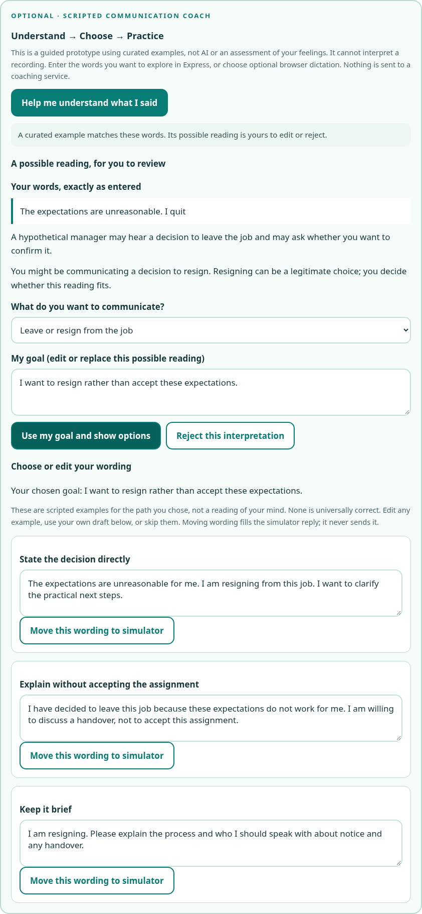
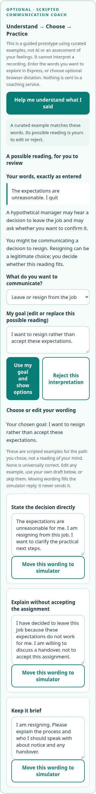
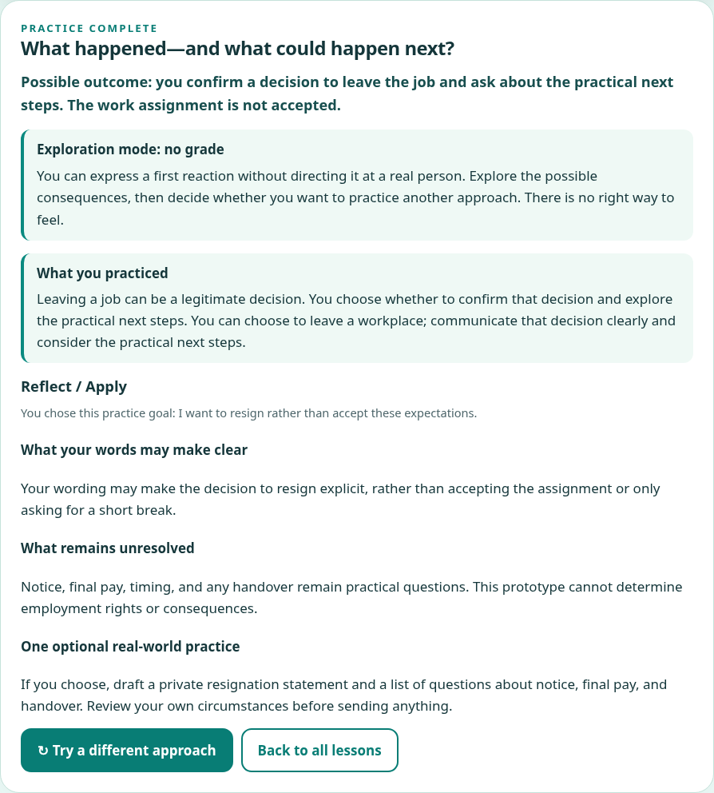

# Issue #1: Communication Coach review

Issue: <https://github.com/humanliteracy/Human-literacy-online/issues/1>

Branch: `feat/issue-1-communication-coach`. Prepared for owner review; no merge or site publication is part of this change.

## Release notes

- Adds an optional, explicitly scripted **Understand → Choose → Practice** coach inside the working Express → Listen Back → Rehearse flow.
- Shows the learner's literal words and a tentative reading for the three curated issue examples. Unknown wording asks for clarification. Goals are editable and interpretations rejectable; no hidden emotion is asserted.
- Offers three editable phrasings for a learner-selected boundary, resignation, scope/time, support, pause, recovery, or custom goal. Moving wording only fills the simulator reply. Sending remains a separate choice.
- Uses authored follow-up dialogue and path-specific reflection without turning resignation or refusal into acceptance of an assignment. No confident numerical score is fabricated for unknown wording or learner-selected goals. Existing optional numeric coaching still works for the original authored conversation choices.
- Retains consent-based local recording, playback, deletion, the 90-second cap, cancellation/race protection, replay, and the neutral illustrated manager. Browser dictation has separate prominent external-service consent, never starts automatically, and cannot run alongside local recording.
- Clearing private practice clears goal wording from pending and later reflections while preserving an already-submitted roleplay path. The simulator reply/history remain separately controlled as disclosed.
- Documents a future server-side interpretation/conversation adapter. **V1 is scripted. V2 AI is a design only**: no backend, model integration, billing, media uploads, or client-side provider keys are activated.

## Actual automated results

Run on October 25, 2026:

```sh
BROWSER_EXECUTABLE_PATH=/usr/bin/chromium npm test
```

- **61 browser tests passed, 0 failed, 0 skipped; 34.5 seconds.** No retries are configured.
- Site audit: **13 shipped HTML pages, 0 broken links/errors**, with the 10 existing static-H1 warnings. Lesson headings are generated by JavaScript and verified in browser tests. Generated Playwright reports/results are excluded from the site audit.
- JavaScript syntax check: **13 shipped inline/external scripts parsed successfully**.
- `git diff --check`: passed.
- `git diff --quiet bcb4e4f -- lessons media index.html`: passed. All ten approved lessons, both approved videos, and homepage are unchanged from the base `main` revision.

The suite includes all previous 33 lesson/simulator tests plus 28 coach/dictation cases. It exercises the three issue examples, unknown wording, editable/rejected goals, all seven paths, explicit transfer without submission, private cleanup, literal-text rendering, keyboard controls, named labels, readable mobile alternatives, and path-specific reflection. It also retains actual browser encoding/playback with a synthetic microphone, permission denial, late permission resolution, deletion during finalization, track cleanup, real navigation, replay, optional scoring, ten complete lesson workflows, both videos, and homepage navigation.

Local versions: Node.js 24.19.0, Python 3.12.14, Playwright 1.64.1, system Chromium 154.0.8037.57. The existing CI workflow runs `npm test`; remote CI results have not been verified here.

## Screenshots

Desktop, 1120px browser viewport:



Mobile, 390px browser viewport (automated layout also tested at 320px):



Completed resignation path, with no default grade and resignation-specific real-world practice:



## Limits and review focus

Browser speech-to-text tests use a mocked API and do not contact a real external speech provider. Recording tests use a synthetic microphone, not a physical device. Live speech-service processing/retention, physical microphone quality, Firefox, Safari, mobile operating-system permission dialogs, and screen-reader software were not tested. Keyboard navigation, semantic labels, and mobile dimensions were tested; this is not a full accessibility audit.

V1 only matches the three curated examples automatically. Other phrases deliberately require manual goal clarification. Existing direct, uncoached roleplay rules remain a limited script. Review the authored wording and learner choices before considering a merge. A future genuinely contextual service would need the separate owner-approved backend and consent contract in [the adapter design](communication-coach-adapter.md).
